# rtdd reference

The details that used to sit in the [README](../README.md): the full install, update and
uninstall prose, every supported agent with its limitations, what rtdd writes, how it picks
and what it cannot see, the exit codes, `RTDD_EVENT_LOG`, graphify, and the benchmark
verdicts with the v0.2 record.

- [Install, update and uninstall](#install-update-and-uninstall)
- [Supported agents](#supported-agents)
- [Setting up a repository](#setting-up-a-repository)
- [What rtdd writes](#what-rtdd-writes)
- [How it picks](#how-it-picks)
- [Commands and exit codes](#commands-and-exit-codes)
- [Recording every invocation](#recording-every-invocation)
- [graphify is optional](#graphify-is-optional)
- [What it cannot see](#what-it-cannot-see)
- [Does it work?](#does-it-work)

## Install, update and uninstall

```
npx github:VocanicZ/rtdd
```

One command, the same on Linux, macOS and Windows. It needs Node 18 or newer — `npx` is what
makes a single line work in bash, PowerShell and `cmd` alike, where no shell script can:
stock Windows has no POSIX `sh`, and Linux and macOS have no PowerShell.

It downloads the release binary for your platform, checks it against the published
`checksums.txt`, puts it on your PATH, and installs the agent skill below. `--version=<tag>`
pins a release, `--install-dir=<path>` chooses where the binary goes.

Or build from source, with Go 1.24 or newer, if you would rather not involve Node:

```
git clone https://github.com/VocanicZ/rtdd && cd rtdd
go build ./cmd/rtdd
```

The installer also installs a **machine-wide agent skill**, so your coding agent knows rtdd
exists in every repository — including ones where rtdd has not been set up yet, where the
skill tells it to run `rtdd init` first. It is written only for agents you already have, and
only into directories rtdd owns — never into your `~/.codex/AGENTS.md` or
`~/.gemini/GEMINI.md`; [What rtdd writes](#what-rtdd-writes) lists every path. Pass
`--no-skill`, or set `RTDD_NO_SKILL=1`, to install the binary alone.

[Supported agents](#supported-agents) lists each agent rtdd installs for and its
limitations. For any other agent, or one without a file-based user level, `rtdd skill
prompt` prints a self-contained document to hand it.

```
rtdd skill install     # (re)install the machine-wide front-ends
rtdd skill prompt      # print a copy to paste into any other agent
rtdd skill uninstall   # remove them
```

`rtdd update` replaces the binary with the latest release, and only if it is newer, then
runs the new binary to refresh the machine-wide skill to match — so an agent the new
release supports gets the skill too; `rtdd update --check` asks without installing. Every
`rtdd update`, already-current included, and every `rtdd init` also install the skill for
an agent that is present and lacks it — one installed after rtdd was, or a skill deleted.
`rtdd uninstall` removes what `rtdd init` wrote into a repository, leaving `.rtdd/` unless
you add `--state`, and the machine-wide front-ends unless you add `--global`.
`rtdd uninstall --legacy-files` removes what an older rtdd wrote outside its own files.

## Supported agents

rtdd installs its instructions into a directory each agent reads and rtdd owns. An agent
that reads only a shared file — an `AGENTS.md`, a `GEMINI.md`, a rules pane in its settings —
has no directory rtdd can own, so rtdd never writes that file on its own: such an agent gets
only the explicit opt-in `rtdd init --append-to <file>`, which touches nothing outside rtdd's
markers. An agent is listed here only when every row of the feature × agent matrix
(`cmd/rtdd/agent_matrix_test.go`) — install, `--project-skill`, `rtdd update`, uninstall and
`--legacy-files`, `rtdd doctor`, the same instructions, `RTDD_EVENT_LOG` — passes for it.

| agent | user level | project level (`--project-skill`) | verified | limitations |
| --- | --- | --- | --- | --- |
| Claude Code | `~/.claude/skills/rtdd/` | `.claude/skills/rtdd/SKILL.md` | verified on Claude Code 2.1.311, 2026-10-27 | none |
| Antigravity | `~/.gemini/config/skills/rtdd/` | `.agents/skills/rtdd/SKILL.md` | verified on agy 1.1.27, 2026-10-27 | also reads `GEMINI.md` and `AGENTS.md` as rules; rtdd writes neither |
| Codex | `~/.agents/skills/rtdd/` | `.agents/skills/rtdd/SKILL.md` | verified on codex-cli 0.154.0, 2026-10-27 | `~/.agents/skills/` is shared with other agents; `rtdd skill uninstall` removes rtdd's copy for all of them |
| Gemini CLI | `~/.gemini/extensions/rtdd/` | `.agents/skills/rtdd/SKILL.md` | verified on Gemini CLI 0.65.0, 2026-10-27 | the project skill loads only in a folder Gemini CLI trusts |
| Copilot CLI | `~/.copilot/skills/rtdd/` | `.agents/skills/rtdd/SKILL.md` | verified on @github/copilot 1.0.104, 2026-10-27 | a `COPILOT_HOME` other than `~/.copilot` is not followed; set `RTDD_HOME` to its parent |
| Cursor | `~/.cursor/skills/rtdd/` | `.cursor/rules/rtdd.mdc` | verified on Cursor 2.4, 2026-10-27 | User Rules live in Cursor's settings and are not written; the `agent` CLI reading `~/.cursor/skills/` is unverified |
| OpenCode | `~/.config/opencode/skills/rtdd/` | `.agents/skills/rtdd/SKILL.md` | verified on opencode-ai 1.19.4, 2026-10-27 | also reads `~/.claude/skills/` and `~/.agents/skills/`, so it may list rtdd more than once; every copy is the same text |
| Zcode | `~/.zcode/skills/rtdd/` | none | verified on ZCode 3.16.3, 2026-10-27 | a desktop app, not a CLI; no documented project-level path, so `--project-skill` writes nothing for it; press Refresh under Settings → Skills after installing |
| Hermes Agent | `~/.hermes/skills/rtdd/` | `.agents/skills/rtdd/SKILL.md` | verified on Hermes Agent v0.22.5, 2026-10-27 | the project skill loads only after `hermes skills trust`, which rtdd never runs |
| OpenClaw | `~/.openclaw/skills/rtdd/` | `.agents/skills/rtdd/SKILL.md` | verified on openclaw 2026.10.7, 2026-10-27 | its project is a workspace (`~/.openclaw/workspace` by default), so the project skill is read only when the repository is the workspace |

## Setting up a repository

```
cd your-repo
rtdd init      # .rtdd/config.yaml and .rtdd/.gitignore — nothing outside .rtdd/
rtdd which     # the tests your current changes need, in rounds
```

`rtdd init` sets up any git repository, whatever it is written in, and writes only inside
`.rtdd/`: a `.rtdd/config.yaml` of defaults and a `.rtdd/.gitignore` that keeps
`.rtdd/graph.json`, rtdd's rebuildable graph cache, out of git. Your `AGENTS.md`,
`CLAUDE.md`, `.gitignore`, `.claude/` and `.cursor/` stay yours. It never overwrites a
config you have set. There is no other setup step: the graph is built the first time a
command needs it. Commit `.rtdd/`.

The agent instructions come from the machine-wide skill. A team that wants them committed
for every contributor opts in: `rtdd init --project-skill` also writes rtdd's own Claude
Code skill and Cursor rule into the repository, and `--append-to <file>` merges rtdd's
marker-delimited block into a shared file you name, such as `AGENTS.md`, touching nothing
outside the markers.

On a repository set up by v0.2, `rtdd init` also deletes the state that release kept — its
map, its metadata, its host language definitions and its `.gitattributes` merge line, plus
v0.1's JUnit report — and prints one line for each file it removes. A config v0.2 wrote is replaced by v0.3.0's
defaults.

An older `rtdd init` also wrote outside `.rtdd/` unasked, and an older `rtdd skill install`
merged a block into `~/.codex/AGENTS.md` and `~/.gemini/GEMINI.md`. `rtdd init`, `rtdd
doctor` and `rtdd update` report each piece of that footprint and leave it alone; `rtdd
uninstall --legacy-files` removes exactly it — blocks by their markers, so your own text is
left byte-identical — and prints each change.

## What rtdd writes

Everything rtdd writes is a file or directory rtdd owns, except where you name a shared file
with `--append-to`.

| Path | Written by | When |
| --- | --- | --- |
| `.rtdd/config.yaml` | `rtdd init` | always; never overwritten once there |
| `.rtdd/.gitignore` | `rtdd init` | always; holds `graph.json` |
| `.rtdd/graph.json` | any command that builds the graph | the rebuildable cache; ignored |
| `.claude/skills/rtdd/SKILL.md` | `rtdd init --project-skill` | opt-in |
| `.agents/skills/rtdd/SKILL.md` | `rtdd init --project-skill` | opt-in |
| `.cursor/rules/rtdd.mdc` | `rtdd init --project-skill` | opt-in |
| rtdd's block in a file you name | `rtdd init --append-to <file>` | opt-in |
| `~/.claude/skills/rtdd/SKILL.md` | `rtdd skill install`, the installer | when `~/.claude/` exists |
| `~/.gemini/config/skills/rtdd/SKILL.md` | `rtdd skill install`, the installer | when `~/.gemini/config/` exists — Antigravity |
| `~/.agents/skills/rtdd/SKILL.md` | `rtdd skill install`, the installer | when `~/.codex/` exists — Codex |
| `~/.gemini/extensions/rtdd/gemini-extension.json`, `~/.gemini/extensions/rtdd/GEMINI.md` | `rtdd skill install`, the installer | when `~/.gemini/settings.json` or `~/.gemini/oauth_creds.json` exists — Gemini CLI, not an Antigravity-only `~/.gemini/` |
| `~/.copilot/skills/rtdd/SKILL.md` | `rtdd skill install`, the installer | when `~/.copilot/` exists — Copilot CLI |
| `~/.cursor/skills/rtdd/SKILL.md` | `rtdd skill install`, the installer | when `~/.cursor/` exists — Cursor |
| `~/.config/opencode/skills/rtdd/SKILL.md` | `rtdd skill install`, the installer | when `~/.config/opencode/` exists — OpenCode; a link to the canonical copy |
| `~/.zcode/skills/rtdd/SKILL.md` | `rtdd skill install`, the installer | when `~/.zcode/` exists — Zcode |
| `~/.hermes/skills/rtdd/SKILL.md` | `rtdd skill install`, the installer | when `~/.hermes/` exists — Hermes Agent; a link to the canonical copy |
| `~/.openclaw/skills/rtdd/SKILL.md` | `rtdd skill install`, the installer | when `~/.openclaw/` exists — OpenClaw; a link to the canonical copy |
| `~/.local/share/rtdd/skill/SKILL.md` | `rtdd skill install`, the installer | the canonical copy, when an agent above links to it |
| the `rtdd` binary | the installer, `rtdd update` | on your PATH, or `--install-dir` |

An agent directory that does not exist is skipped rather than created. An agent verified
to load a `SKILL.md` through a symbolic link ([docs/agent-capabilities.md](agent-capabilities.md#symbolic-links))
gets a link to one canonical copy rtdd owns, so a refresh rewrites one file; the rest get a
copy each. A file or link at rtdd's path that rtdd did not make is left alone without
`--force`. `rtdd skill uninstall` removes every `~/` directory rtdd owns, links included; `rtdd uninstall --state` removes
`.rtdd/`. v0.3.0 wrote Codex's skill to `~/.codex/skills/rtdd/`; `rtdd skill install`
removes that directory when every file in it is rtdd's render, and otherwise removes only
rtdd's files and keeps the directory with yours.

## How it picks

rtdd builds a graph of the repository's functions, methods and classes, links every test to
the code it calls, and reads the lines you changed against it:

<picture>
  <source media="(prefers-color-scheme: dark)" srcset="results/figures/how-it-picks-v3-dark.svg">
  
</picture>

- **Round 1** — the tests linked to the code you changed, and every test you changed.
- **Round 2** — the tests linked to that code's direct neighbours, its callers and its
  callees, minus Round 1. A changed prose, data or test file adds nothing to Round 2: a
  file that defines nothing (a changelog, a doc, a `.tsv`) only names other files, and a test
  only calls the code under test, so changing either cannot change what its neighbours do.
  Prose and data select the tests that read them in Round 1; a test selects itself. Round 2
  for a change to code and tests together comes from the code.
- **Round 3** — the full suite, once, at the end of the task.

Take `src/calc.py`, where `total` calls `add`, and `tests/test_calc.py` with `test_add` and
`test_total`. Edit `add`, and:

```
$ rtdd which
graph: scanner, built at aeb07e0, 0 stale files
changed nodes:
  src/calc.py::add  (lines 1-2)
Round 1 — run these first:
  tests/test_calc.py::test_add
Round 2 — then these:
  tests/test_calc.py::test_total
Round 3 — the full suite, once, at the end
untested:
  none
```

`test_add` calls the function you changed, so it is Round 1. `test_total` never names `add`,
but it calls `total`, which does — so it is Round 2. A path heuristic would stop at the first.

The changed set is everything that differs from `--base` (default `HEAD`): committed since
it, staged, unstaged and untracked, so a file you just wrote counts before you commit it. A
changed line outside every function, such as an import, belongs to its file's `<module>`
node. A file that defines nothing — a prompt, a config, data, a template, any extension —
is one node, its path: a test that names it (`"prompts/impl.md"`, `config.yaml`) is Round
1 when it changes, and so is the test of a function that names it. `untested` lists the
changed nodes and files no test in Round 1 or Round 2 reaches.

When Rounds 1 and 2 are both empty, `rtdd which` prints `no linked test`. That is exactly
what it means — nothing links a test to the code you changed — and never a pass. Round 3
still runs the full suite once at the end.

Files ending in `.log`, `.jsonl`, `.txt`, `.out`, `.csv` or `.tsv` are never tests, even
under `test/` or `tests/`, whatever `test_files` says: they hold output or data.

When Round 1 and Round 2 together select more than half of all tests (and the repository has
at least 10), `rtdd which` warns of it: a change that selects most of the suite usually names
much of the repository, and the warning says so before you run it.

`rtdd which --json` is the same answer as one object, schema 3, for tools that read it. The
selection warning is also its Round 2 object's `large_selection` field and a `warnings` entry.

The rounds can also run across spare machines with
[swarm](https://github.com/VocanicZ/swarm). `rtdd which --swarm-job .rtdd/swarm --run
'pytest {tests}'` writes a swarm job — one shard per test file of Round 1, then Round 2,
with `{tests}` replaced by that file's path — and prints its name; `swarm submit
.rtdd/swarm` runs it, and its merge exits non-zero when any shard's command failed. rtdd
still runs nothing: it only writes the job. The job dir must be inside the repository,
which is the job's workdir.

## Commands and exit codes

```
rtdd graph [--json]                the graph's source, node, edge and test counts, staleness
rtdd explain <file[:line]|name>    a node's tests, callers and callees
rtdd doctor                        graph source, graphify staleness, test files found, names defined 8+ times
rtdd uninstall [--state]           remove what init wrote
rtdd uninstall --legacy-files      remove what an older rtdd wrote outside .rtdd/
rtdd update                        replace the binary with the latest release
rtdd --version                     print the version
```

Exit codes: 0 success, empty rounds included; 2 usage; 3 environment (not a git repository,
a graph that cannot be built). No exit code is a test result, because rtdd runs none.
It is a context provider, not a gate.

## Recording every invocation

Set `RTDD_EVENT_LOG=<path>` and every `rtdd` command appends one JSON line to that file
as it exits, so a caller can count what rtdd did without parsing its output. rtdd creates
the file if it is missing. Each line is a single `O_APPEND` write of less than 4 KiB, so
concurrent rtdd processes never mix their lines. When the variable is unset, rtdd writes
nothing. A failed write is ignored and never changes rtdd's output or exit code.

```json
{"v":1,"ts":"2026-10-26T09:14:03.120Z","cmd":"which","argv":["which","--base","origin/main"],
 "cwd":"/src/app","repo":"/src/app","version":"0.3.0","base":"origin/main","head":"8f1e72b",
 "exit":0,"duration_ms":412,
 "graph":{"source":"scanner","built_at":"8f1e72b","stale_files":0,"nodes":1234,"edges":5678,"cache":"warm"},
 "changed_nodes":6,"round1":31,"round2":12,"untested":1,"deleted_warnings":0,
 "ctx":{"HARNESS_ISSUE":"503"}}
```

Each line is schema `v: 1`. A field that does not apply to the command is omitted:

- `graph` appears on every command that builds the graph. `cache` is `warm` when
  `.rtdd/graph.json` was usable, so rtdd only rescanned changed files.
- `which` adds the counts that `rtdd which --json` reports: `changed_nodes`, `round1`
  and `round2` (tests), `untested` and `deleted_warnings`.
- `doctor` adds `findings`: the names defined 8+ times plus the legacy files it lists.
- `init` adds `init.steps`, a count of each action in its plan (`create`, `delete`,
  `legacy`, …), plus `init.dry_run` when `--dry-run` was given.
- `ctx` copies every `HARNESS_*` environment variable, so a caller can tag events
  without rtdd knowing anything about it.
- If a line would reach 4 KiB, rtdd drops `argv` first, then `ctx` and `cwd`, and sets
  `"truncated":true`.

rtdd runs no tests, so it never records a test result.

## graphify is optional

rtdd's own scanner builds the graph from the text of the source, and needs nothing
installed: no language toolchain, no test framework, no coverage tool. If the repository
has a graphify graph at `graphify-out/graph.json`
(`graphify_path` in `.rtdd/config.yaml` moves it), rtdd uses it as well. It never trusts it
for changed files — rtdd rescans every file that changed since graphify built its graph,
and ignores the graph entirely, saying so, when more than half of it is stale. rtdd never
runs graphify: if you want its graph, run or update graphify yourself.

## What it cannot see

Stated plainly, because a tool that hides its blind spots is worse than none:

- Links are by name, narrowed without a parser: a call links to its own class's
  definition, its receiver's declared type's, then the ones in its own file, the files it
  imports, or its package. A name still matching more than five definitions links to none
  (`rtdd graph` counts these as `ambiguous_calls`), and a call the narrowing misjudges
  links to the wrong one; `rtdd doctor` lists the names defined eight or more times.
- A call the text does not show — through reflection, a string, a registry or a framework
  hook — has no edge, and its tests are in neither round.
- A file is linked to the code that names its path, or its base name with its extension.
  A path built from pieces (`dir + "/" + name`) names nothing; a base name two files share
  links to both. With graphify, only the files rtdd re-scans name files.
- Depth is one. A caller's caller is in no round; Round 3 is the safety net.
- A deleted file has no lines left to own a node, so the tests that called it are in no
  round. `rtdd which` warns, and Round 3 runs them.
- The scanner reads text, not syntax: an unusual layout can give a node the wrong span.

More in [Limitations](LIMITATIONS.md).

## Does it work?

v0.3.0's rounds were measured on 2026-10-22 against running the full suite every cycle
(`/tdd`), by replaying real commits of both rows of the frozen corpus — `httpie` (17 commits)
and `flask` (25). The run, its method and every figure are in
[docs/results/n4-bench-rounds.md](results/n4-bench-rounds.md). Round 1 cut the time
spent in tests to 0.022 of `/tdd`'s on `httpie` and 0.178 on `flask`; Rounds 1+2 to 0.024
and 0.328. On `httpie` both missed every cycle where the full suite failed (0 of 2); on
`flask` no replayed cycle failed, so recall there is not measured.

The pre-registered verdicts, as the run published them:

`httpie`:

> verdict: change-level recall rtdd=0.000 vs path heuristic=0.000; selected-duration fraction rtdd=0.022 vs path=0.023 — rtdd does NOT clearly beat the naive path heuristic — per the pre-registered criterion in docs/plans/04-m3-replay-benchmark.md the map is not justified and this must be stated in the README

> verdict (probe, upper bound — map seeded at the child commit, never pooled with `natural`): change-level recall rtdd=0.000 vs path heuristic=0.000; selected-duration fraction rtdd=0.000 vs path=0.000 — rtdd does NOT clearly beat the naive path heuristic — per the pre-registered criterion in docs/plans/04-m3-replay-benchmark.md the map is not justified and this must be stated in the README

`flask`:

> verdict: not computable (no detecting commits)

> verdict (probe, upper bound — map seeded at the child commit, never pooled with `natural`): change-level recall rtdd=0.667 vs path heuristic=0.333; selected-duration fraction rtdd=0.036 vs path=0.009 — rtdd does NOT clearly beat the naive path heuristic — per the pre-registered criterion in docs/plans/04-m3-replay-benchmark.md the map is not justified and this must be stated in the README

So, stated plainly: on this corpus rtdd does not clearly beat the naive path heuristic, and
by the pre-registered criterion the graph is not justified. Two rows, one run each, nothing
re-run. Round 3 — the full suite once, at the end — is what catches what the rounds miss.

<!-- rtdd:v0.2-record -->

The measurements below were taken on v0.2.0's coverage selector, which v0.3.0 replaces;
v0.3.0's rounds are measured by [rtdd-bench](https://github.com/VocanicZ/rtdd-bench) (PRD #412).

How v0.2 picked: the seed run recorded which tests executed which files, and a change ran only the
tests that executed it. v0.3.0 picks from a graph of functions instead (see [How it picks](#how-it-picks)).

<picture>
  <source media="(prefers-color-scheme: dark)" srcset="results/figures/how-it-picks-dark.svg">
  
</picture>

RTDD is built for one loop: an agent edits, runs tests, edits again, dozens of times in a
single task. Without it the agent runs the whole suite every time. So there are two
questions — does RTDD save time, and does it miss anything the full suite would catch.

**Every number in this section was measured on the release before the one-pipeline change**
(per-test-case Python coverage): the time table, 4 of 4, the 0.757 fraction, the 12 uncovered
reports with 0 wrong, 486 tests with 16 selected, and 167 ms for `rtdd which`. A first
mechanical measurement on the one pipeline is in
[one-pipeline-first-measure.md](results/one-pipeline-first-measure.md): Go now selects
from a recorded map, and on those small suites `rtdd run` is slower than the full suite. The
agent-session re-measurement is pending.

### It saves time

Ten edits to one module in a real `flask` clone, tests run after each edit. Same machine,
same edits, two copies of the same repository:

| after every change | 10 edits | |
|---|---|---|
| run the whole suite | 28390 ms | |
| `rtdd run` | 19962 ms | **1.42× faster** |

486 tests in the suite, 16 selected. Reproduce with
[`scripts/agent-session-bench.sh`](../scripts/agent-session-bench.sh) against a seeded clone.

RTDD's own cost is inside those numbers. `rtdd which` answers in **167 ms** on this clone,
down from **9774 ms** before its staleness scan was memoised — which was slower than just
running all 486 tests.

The edits above are additive no-ops, so nothing fails in any row. This measures cost only.

### It catches what the full suite catches

Testing that needs commits that actually break something: replay a commit's tests against
its parent's source and watch them fail. Most commits can't — they change only source, or
only tests, or only docs. Picking commits that changed both is what makes the question
answerable at all:

| flask commits replayed | that detect anything |
|---|---|
| 23 most recent | 3 |
| 6 that changed tests and source together | **5** |

Each one is a real commit whose real tests really failed against its parent's real source.
Nothing is injected or mutated. From
[`bench/results/paired/flask/summary.md`](../bench/results/paired/flask/summary.md):

| | caught the change | where one test fails | share of suite time |
|---|---|---|---|
| run the whole suite | 1.000 (5/5) | 1.000 (4/4) | 1.000 |
| **rtdd** | **1.000 (5/5)** | **1.000 (4/4)** | **0.757** |

The middle column is the one to read. Those are the changes where exactly one test stands
between you and a missed regression, and RTDD ran all four of them. Matching the full suite
is the best result available here — a full run catches what it catches by definition.

**How far this goes.** Five commits, one repository. They were chosen for changing tests
and source together, and RTDD's map was seeded at the commit under test, so it knew about
code an agent would not have recorded yet. Enough to measure. Not enough to generalise —
more repositories are what would change that.

RTDD also reports which of your changed lines no test covers. On the published corpus that
report fired 12 times and was wrong zero times. Running the whole suite tells you nothing
about this.

<!-- /rtdd:v0.2-record -->

